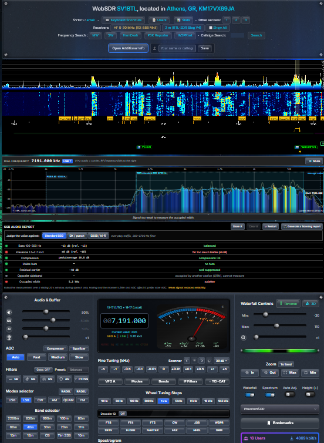
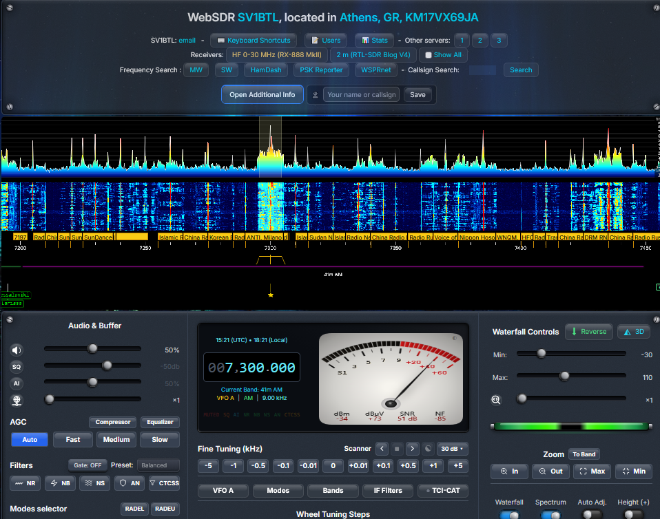
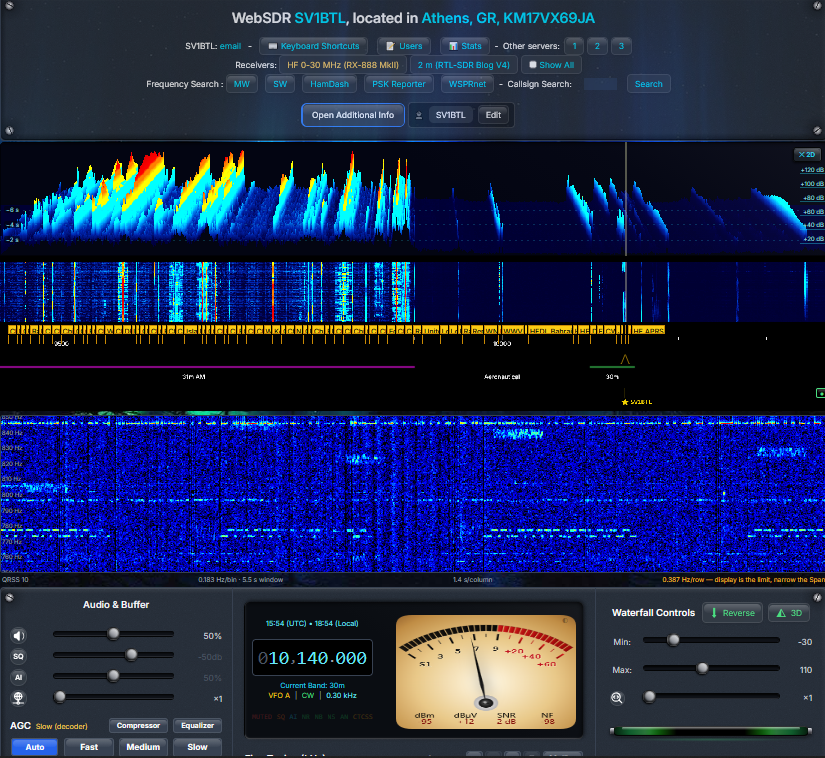
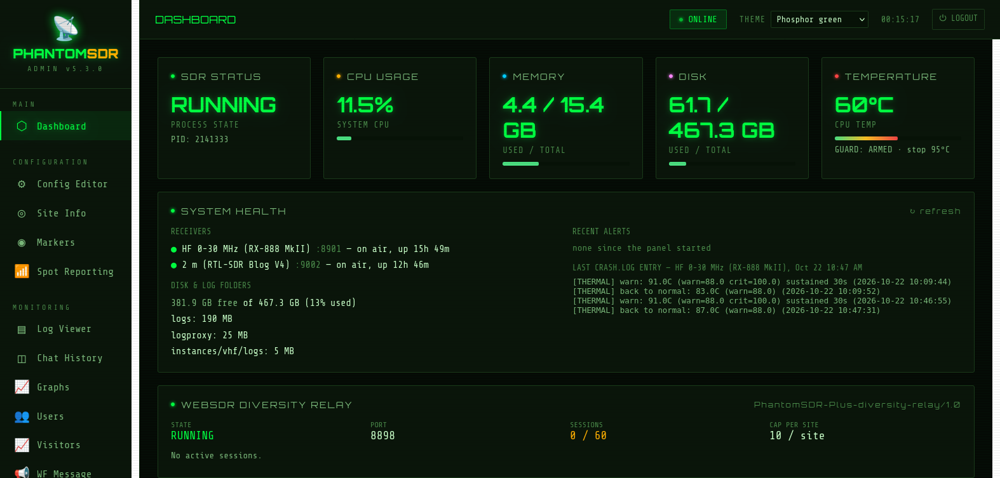

# PhantomSDR-Plus WebSDR (version 5.4.0, November 1st, 2026)

[](https://www.gnu.org/licenses/gpl-3.0)
[](https://github.com/sv1btl/PhantomSDR-Plus)

**Maintained by SV1BTL.** The current version is 5.4.0, and the project lives at
**https://github.com/sv1btl/PhantomSDR-Plus** — that is the one to clone, link to
and report issues against.

PhantomSDR-Plus is licensed under the GPL v3 with the [additional terms](ADDITIONAL_TERMS.md) its section 7 allows: copies and forks must keep the "original from github.com/sv1btl/PhantomSDR-Plus" line visible on the receiver page and on /mobile.

🌐 **Website: [phantomsdr.psychomed.gr](https://phantomsdr.psychomed.gr)** — what PhantomSDR-Plus does, the decoders, the Desktop PhantomSDR+ app, and the documentation PDFs in seven languages.

🎬 **Video tutorial: [PhantomSDR-Plus 5.4.0 — Complete Tutorial](https://www.youtube.com/watch?v=R5UzdGZilcQ)** — every function of the receiver in 18 minutes, recorded live on the SV1BTL station, with subtitles in English, Ελληνικά, Deutsch, Français, Español, Русский and Hrvatski.

## Note: Tested on Debian 12 (Bookworm), Debian 13 (Trixie), Ubuntu 22.04, Ubuntu 24.04.

**What's new in v.5.4.0**

* **RADE V2 (beta).** A **RADE-v2U** button (mode RADE2) before RADE-v1L and RADE-v1U decodes RADE V2, the new waveform of FreeDV 3.0, on USB — on the station's server through FreeDV's rade_c, which `install_rade.sh` builds in `~/rade_c` next to RADE V1 in `~/radae`, at about 1 % of a CPU core per listener. V2 is still a beta at FreeDV. See the [RADE manual](docs/RADE_README.md#rade-v2-beta--rade2).
* **DRM in the Modes pop-up**, after IQ; RADE plays 6 dB lower so it no longer clips; `/mobile` gets a RADE2 button and loses its CW-L button.
* **RADE hears weaker signals.** RADE V2 keeps playing down to about −6 dB SNR when the signal looks like real V2 (it was muted below −2 dB); RADE V1 is resampled in one continuous stream like V2, which helps it most on fading signals; and the RADE2 filter is 1040–1930 Hz, so a strong neighbouring station no longer pulls V2 down. On test signals in noise and HF fading V2 now decodes about 2 dB weaker signals, and V1 gets about a quarter more of the speech through in fading. The RADE buttons read **RADE-v2U**, **RADE-v1L** and **RADE-v1U**, next to the **Modes** heading (was "Modes selector"). See the [RADE manual](docs/RADE_README.md#rade-v2-beta--rade2).
* **DRM decoder.** The **DRM** button decodes Digital Radio Mondiale on the station's server — one ubersdr-drm (the headless Dream decoder UberSDR uses) per listener, on zero-IF I/Q the server taps itself — so it plays in every browser, xHE-AAC included. A station selector lists the DRM Reception Project schedule with days, target area, listener confirmations and HFCC registrations, plus what this receiver has itself decoded in the last 30 days ("heard here" — also transmissions no schedule lists); with DRM on, the only sound is decoded DRM. On weak and fading signals a damaged frame fades into a short reverb and silence instead of a burst of noise, and the decoder resynchronises by itself (on a fading xHE-AAC broadcast: 515 s of programme in 539 s, 153 s before). New stations build it during installation; existing ones run `./setup-drm.sh` once, and again after an update. See the [decoder manual](docs/DECODERS.md#13-drm).
* **HFDL decoder.** The **HFDL** button decodes the messages aircraft exchange with ground stations on shortwave — dumphfdl in WebAssembly, ported from F1NSK's PhantomSDR-ORSAT — with FlightAware links and an aircraft map. See the [decoder manual](docs/DECODERS.md#12-hfdl).
* **Decoder buttons in two rows of six**, the drop-down in the same order; **HFDL**, **DRM** and **MORSE** (the CW decoder) markers start their decoders; AM with the synchronous detector reads **SAM** under the frequency.
* **Tune puts you on what another listener hears.** In the Users window opened from the receiver page, **Tune** copies the listener's frequency and mode, their filter bandwidth and their decoder.
* **Who runs which decoder.** The Users window (`users.html`) shows the decoder each listener is running — FT8, CW, DRM, HFDL… — next to the mode; the User Statistics (`stats.html`) get a **Decoder Popularity** panel and show the decoders in the longest sessions; the admin panel shows them on the Users page and as **Decoders** on the Visitors page.
* **Decoders checked and made more reliable.** FT8, FT4 and FT2 subtract each decoded station and decode the rest again, as WSJT-X does — on real-band recordings they now find 88 % of what WSJT-X finds (74 % before), a crowded 45-station FT8 slot 96 % (57 %) — with ordered-statistics decoding for weak FT8, and FT4/FT2 tolerate a clock up to about a second off. The CW decoder follows fading, keeps the first word, decides each letter on the signal itself (about half the wrong letters on weak signals) and has a **Pitch** slider (500–800 Hz; CW is now at 600 Hz everywhere). WSPR decodes busy bands with three passes and subtraction (15 stations in a slot: 89 % instead of 67 %). SSTV draws weak pictures to the end and recognises Robot 36 caught mid-picture. In the FLDIGI panel MFSK finds a mistuned signal by itself (up to about ±75 Hz), DominoEX stops printing noise after a transmission, and weather RTTY lets far less noise through. NAVTEX keeps its sync on weak signals (about twice the text at −6 dB). **Decoder ID** recognises narrow modes far below its old +10 dB limit — FT8 to about −5 dB, WSPR and CW to about −10 dB — and no longer names speech as CW. False decodes on pure noise stayed at zero throughout. See the [decoder manual](docs/DECODERS.md).
* **Receive diversity on the admin Dashboard.** A **Receive Diversity** card lists every listener combining your receiver with another one — PhantomSDR+, KiwiSDR, UberSDR or WebSDR — with the partner's address.
* **A deeper 3D view.** The 3D spectrum is now as tall as the flat spectrum and narrows towards the back, with lower rows further back; a click on an older row tunes to that row's frequency, and the **⚙** button sets the view's **Angle** and **Depth** (remembered in your browser).
* **IQ for listeners, as on a KiwiSDR or UberSDR.** An **IQ** button after FM sends 12 kHz of the band as raw I/Q — lossless, I left and Q right — with noise kept quiet and strong stations levelled. Recording in IQ saves a WAV that HDSDR, SDR#, SDR++ and SDRuno open already tuned (`PhantomSDR_<UTC>_<Hz>Hz_IQ.wav`), and Kiwi clients get it with `SET mod=iq` (`kiwirecorder.py -m iq`). An **IQ Demodulators** panel runs up to six receivers inside those 12 kHz in the listener's browser — each with its own mode (USB, LSB, CW, AM, DSB with carrier lock, FM), frequency, width, volume and pan, so both sides of a split can be heard at once, one in each ear. On by default; `iq = false` under `[server]` turns it off. See the [User Guide](docs/USER_GUIDE.md#iq-raw-iq).
* **SAM shows its carrier.** While SAM runs, `SAM +3.2 Hz · 97%` under the status indicators gives the station's carrier offset from the dial and how well the detector is locked.
* **Static IF Filters** offer 12.5 kHz in place of 4.5 kHz, and **To Band** leaves 10 kHz to spare at each band edge.

**What's new in v.5.3.0**

* **Your name or callsign, as on a WebSDR.** A box next to **Open Additional Info** takes your name or callsign — up to 10 characters, no spaces; left blank, you are anonymous plus a number. It shows in the Connected Users window and on its map, on your chat lines, and on your label under the other listeners' waterfall, followed by your location ("SV1BTL-Athens"); your own ★ carries it too. It is kept in your browser and follows you to the station's other receivers. On a phone the box sits above the frequency display. The chat panel no longer has a name field of its own.
* **Hover over a listener's label** under the waterfall to see the frequency and mode they are tuned to; click it to tune there.
* **No IP addresses in public.** As on a WebSDR, the public users list (`/users`, `users.json`) and the User Statistics no longer show any listener's IP address. The statistics count unique visitors by an anonymous code; the log files on disk keep the addresses for the sysop.
* **Admin panel:** the Users page shows each listener's name, location and IP address, and **⛔ Ban ▾** next to **⚡ Kick** disconnects a listener from every receiver and refuses them for 8, 16 or 24 hours — kept across receiver restarts, with a list of active bans and an **Unban** button. The listener map now uses OpenStreetMap, like the APRS map.
* **A renewed Admin Panel.** **Alerts** by email and/or Telegram when a receiver goes off the air, comes back or is restarted, the thermal guard changes stage, or `crash.log` gets a new entry (Settings → Alerts, with a ✉ Send test). **Backup & restore** of the station's own settings — configs, `receivers.toml`, `station.conf`, site information, markers, band settings, relay, spot reporting, bans and every extra receiver — as one zip; a restore keeps each file it replaces in `admin-backups/`. A **Visitors** page with private statistics for 1 to 31 days: visitors, sessions, listening hours, most at once, busiest hours, countries, and the addresses with the most sessions at the same time, each with Ban 24h. A **System Health** card on the Dashboard: every receiver on air or off with its uptime, free disk and log folder sizes, the last `crash.log` entry. And **themes** — Phosphor green, Amber display, Metal panel, Modern dark, Light, and Auto (light from sunrise to sunset at the station's locator, dark at night) — picked with **THEME** in the top bar of every page. See [docs/ADMIN_PANEL_SETUP.md](docs/ADMIN_PANEL_SETUP.md).
* **The mouse wheel tunes anywhere in the black frequency box.** Over a digit it steps that digit as before; anywhere else in the box — the band name, the mode line, the clock — it tunes by the tuning step (Shift 1 kHz, Alt 10 kHz). Only the analog S-meter is left out, so the wheel over it scrolls the page.
* **Softer Noise Reduction.** NR now keeps about 1 dB more of the voice on weak signals and is more intelligible at every signal level — measured on 80 SSB test recordings with real band noise — for about 2 dB less noise removed between words.
* **The 3D view in the waterfall's exact colours.** The 3D spectrum no longer adds light and shade of its own: every point has exactly the colour the waterfall gives that level.
* **Decoders show the signal frequency.** While HF FAX, NAVTEX or the FLDIGI window is on, the frequency meter shows the station's own frequency — NAVTEX reads 518.000, not the 517.500 the receiver is tuned to in USB — and a frequency typed then is taken as the signal's. Decoding, the filter and the waterfall work exactly as before.
* **Decoder frequency lists re-checked.** The WeatherFAX, NAVTEX, maritime FSK (SITOR) and DWD weather RTTY frequencies and timetables were checked against NOAA, the IMO NAVTEX list, USCG NAVCEN and DWD on 22 October 2026, and are all current.
* **Documentation:** the User Guide (also the wheel in the frequency box and the NR figures), Admin Panel (also alerts, backup & restore, visitors, system health and themes), Connection Limits, Several Receivers and Project Structure manuals cover all of the above in all seven languages, and the offline PDFs are rebuilt.

------------------

We also provide a wide range of additional **features**:

* A new `install.sh` installation procedure that simplifies the initial server setup, starting with a station wizard (`configure-station.sh`): the receiver, band, station and ports are asked once and kept in `station.conf`, every config is written from it, and new stations publish a single public port (9000, `proxy.py`).
* **https:// alongside http://** — `setup-https.sh` puts Caddy with a self-renewing Let's Encrypt certificate on port 443, while the http address keeps serving websdr.org, Kiwi clients and http-only partners.
* A `recompile.sh` script for quickly rebuilding the backend, the frontend, or both.
* An `update.sh` tool that updates the receiver with one command, keeping your configs, markers, logs and edited scripts untouched; each update's backup is one dated archive in `update-backups/`, restorable with `./update.sh --restore LAST`; `./update.sh --from` takes the new version from a folder, `.tar.gz` or `.zip` for a station without GitHub, and each release carries the fingerprint of every published file, so only real local edits are asked about.
* Installers that stop a running receiver first, frame every step with its own verdict, and spell out the default of each question.
* A **Thermal Protection** function in Admin Panel, to avoid thermal stress of the CPU and take the proper actions.
* A modern, futuristic user-interface design.
* **CATsync** support through the [CATsync Tool for WebSDRs](https://catsyncsdr.wordpress.com/) application, **TCI-CAT** on the receiver page itself (ExpertSDR, AetherSDR, Thetis, or any Hamlib rig through the included bridge), and two-way rig control — frequency, mode and filter — in [Desktop PhantomSDR+](https://www.dropbox.com/scl/fo/kjwj96zg3kj7dgq4fjef9/APnA3c9hhv4hk3YMGIGjH7s?rlkey=jfiwklly63kv73poalx631pk3&st=m37uvaym&dl=0). See [docs/RIG_CONTROL.md](docs/RIG_CONTROL.md).
* **KiwiSDR client emulation** — an optional bridge that lets Kiwi clients such as **AetherSDR** and `kiwiclient` connect to the receiver directly, on the same host and port, with real retuning, waterfall and S-meter. Off until `[kiwi_emulation] enabled = true` is added to your config. See [docs/Aether_config.md](docs/Aether_config.md).
* **Receive diversity** — pair the receiver with a second site (another PhantomSDR-Plus, a KiwiSDR, an UberSDR or a WebSDR) and hear whichever of the two currently has the better signal. It runs in the listener's browser; only a WebSDR as the partner needs a small relay on your own server. See [docs/RECEIVE_DIVERSITY.md](docs/RECEIVE_DIVERSITY.md). It switches even while the two streams are not yet aligned, so a station heard only by the remote comes through.
* **Several receivers on one computer** — for example an RX-888 for HF and an RTL-SDR for 2 m, each a complete server of its own with its own waterfall, chat, markers and listeners. `./add-receiver.sh` (also offered at the end of every installer) adds one, with its driver; `start-all.sh` starts them all and `./stop-websdr.sh <name>` stops one. On the page a *Receivers:* line, on /mobile too, switches between them, and `proxy.py` lets them share one public port. See [docs/MULTI_RECEIVER.md](docs/MULTI_RECEIVER.md).
* On a station with several receivers, **Show All** puts each other receiver under the waterfall as a live strip — click it and that receiver opens there; each receiver's page remembers where you were, and a frequency only another receiver covers (typed, from a link, a spot, the chat or a label) opens that receiver by itself.
* An S-meter that reads **VHF S-units above 30 MHz** (IARU Region 1: S9 is −93 dBm there, −73 dBm below), with an optional rest-at-zero on an empty VHF/UHF channel (`"siteSMeterGateDb"`).
* The sysop's kick and the `X-Forwarded-For` header are trusted only from the same machine, so nobody can kick listeners or slip past the per-IP limits through the proxy.
* Optional server settings for multi-receiver stations: `[server] host`, `[server] html_fallback_root`, `[websdr] public_port`, and per-receiver `siteReceiverURL` / `siteAntennaURL` links.
* A full-featured, password-protected Admin Panel for remote server management without requiring direct SSH access. It provides access to server logs, chat moderation, user messaging, chat-message deletion without restarting the server, user disconnection, command execution, file editing, and other administrative functions; its Users and Chat pages cover every receiver of the station.
* Integrated decoders for **FT8, FT4, FT2, JS8, CW, QRSS Grabber, WSPR, HF FAX, SSTV, NAVTEX, an FLDIGI window with RTTY, PSK31, Olivia, MFSK16/32/64, DominoEX, THOR, THROB, Hellschreiber, MT63, Packet (AX.25) and APRS (with a live map of the stations heard), HFDL (aircraft messages, with a live aircraft map), DRM (digital broadcasting, decoded on the server) and FreeDV RADE V1 and V2 (beta)**. RTTY, PSK31, FT8, FT4 and FT2 show a real SNR (the FT modes agree with WSJT-X), and RTTY has a squelch. The FLDIGI modes are ports of fldigi's own receivers, checked against real fldigi recordings, with no fldigi installed anywhere; Hellschreiber is shown as a picture that can be saved as a PNG. A frequency marker whose mode is a digital mode starts its decoder in one click. See the [decoder documentation](docs/DECODERS.md).
* A **channel scanner** on the tuning row: it sweeps the band — or exactly what the waterfall is showing — and stops on the first channel rising a chosen number of dB above the band noise floor, resumes by itself when the channel goes quiet, keeps the step on the mode's own channel grid, and can skip empty channels by reading the spectrum. Locked-out channels and settings live in the listener's browser.
* A **Decoder ID** tool that identifies an unknown digital signal and offers the matching decoder in one click. Off by default.
* Picking a digital mode sets both the sideband and the passband.
* JS8 is shown as a conversation panel, with multi-frame messages reassembled.
* Integrated **C-QUAM AM Stereo** decoding. C-QUAM audio uses Opus compression by default, while the remaining audio modes use FLAC.
* All decoders have been moved off the main browser thread. Each decoder now runs in its own Web Worker, preventing signal decoding from competing with audio playback and GUI processing.
* Automatic spot reporting to **PSK Reporter** and **WSPRnet**. A built-in autorun engine locally decodes off-air signals and uploads reception reports without requiring additional software:
  * **FT8, FT4 and JS8 → [PSK Reporter](https://pskreporter.info/)** using the native IPFIX/UDP protocol. Spots are batched and transmitted at the recommended interval of at least five minutes. JS8 is spotted at Normal speed, from heartbeats, compound frames and directed messages; group destinations such as `@ALLCALL` and unresolved callsigns are never reported.
  * **WSPR → [WSPRnet](https://wsprnet.org/)** using the standard WSPRnet upload endpoint. WSPR reports are sent only to WSPRnet to prevent duplicate submissions.
* Integrated **FreeDV Reporter and DX Cluster tools**.
* Chat with a **↪ Reply** button on every message; answers appear indented under the message they answer, on the desktop page and on /mobile. Messages are measured in characters, so Greek and Cyrillic get the full 200.
* **Automatic C-QUAM status indication**. When a C-QUAM transmission is detected, the button label turns green. While operating in AM mode, pressing the button again enables synchronous AM detection on the carrier. The label then turns yellow and displays `SAM`. Pressing the button once more returns the receiver to standard AM mode.
* A configurable band-plan overlay on the waterfall, with independent brightness, frequency-range, and visibility settings for each band; the 2 m modes follow the IARU Region 1 band plan.
* An improved custom colour-map system. A reversed spectrum and waterfall layout is used by default across all interface variants, although this behaviour can be changed manually.
* Optimized FLAC and Opus encoders with balanced latency. Both operate at 16-bit resolution, providing a theoretical dynamic range of approximately 96 dB. ⭐
* Numerous redesigned and optimized functions, including:
  * Reduced end-to-end latency: the browser's own FLAC decoder plays each packet the moment it arrives, and the playback buffer sizes itself to the connection (about 140 ms on a phone over Wi-Fi; add `?diag=1` to the address to see the figures). On https pages the buffer also trims itself back after a burst, by playing 0.25 % faster for a while, which cannot be heard (`?drain=0` turns it off). See [Audio latency](#audio-latency) for a measured comparison with other web receivers.
  * Noise Reduction (spectral, tone-preserving).
  * Noise Cancellation.
  * Noise Blanker (impulse).
  * Background Noise Suppression.
  * Auto Notch for heterodynes and carriers.
  * AI Noise Reduction (RNNoise, in the listener's browser, voice modes only).
  * All of the above bypass the decoders, which read raw audio.
  * Synchronous AM enabled by default.
  * Transceiver-style AGC: Fast, Medium and Slow timed in the server for each listener, and Auto, the receiver's own; a running decoder holds it on Slow and says so.
  * Automatic squelch.
  * CTCSS tone squelch (FM), with a pop-up picker for the subtone.
  * Configurable buffer settings.
  * Auto Adj.: automatic waterfall brightness and contrast from the measured noise floor, the same with every colour map.
  * 3D spectrum: the last seconds of the band in relief, in the waterfall's colours and levels (WebGL2, in the listener's browser).
  * Mouse-wheel frequency tuning, with a 12.5 kHz step for the VHF channel grid.
  * A number pad on the frequency box; a typed frequency frames its band as the band button would.
  * Band buttons remember your last frequency on each band; a second click returns to the band's default.
  * A cursor line with its MHz readout on both the spectrum and the waterfall.
  * Keyboard shortcuts.
  * Zoom slider.
  * Enhanced mobile GUI.
  * Selectable Noise Gate with presets.
  * Precise mouse-based tuning with a frequency readout directly on the waterfall.
* Integrated audio Compressor and Equalizer, with manual configuration and reset controls.
* Redesigned bookmarks with on-screen labels and import/export functionality.
* Four selectable GUI templates, accessible through a floating pop-up menu.
* Support for running the GUI through `localhost`.
* An optional monitoring tool that adds real-time server-status information to the PhantomSDR application.
* An audio analyser (the Spectrogram section's **📊 Show**): the demodulated audio as a spectrum with an axis that follows the mode, the recommended bandwidths and your current filter; an RF view of the station in AM and FM; the station's occupied width with a splatter verdict; and, in USB/LSB, an SSB audio report (tonal balance, compression, mains hum, residual carrier, opposite sideband) with a listening report to download; in AM/FM an AM/FM report (modulation depth, sideband balance, deviation, CTCSS tone). It works at any zoom. Adapted from PhantomSDR-ORSAT by F1NSK.
* A “Magic Eye” signal-strength indicator that emulates the behaviour of EM84 tuning-indicator tubes used in vintage radio receivers.
* Audio recording and combined video/audio recording of either the complete waterfall (with the 3D spectrum when it is open) or a user-selected region.
* A real-time connected-user list with geolocation data, map integration, and user statistics covering configurable time periods. Your own session is marked **you** in the list, whether it is opened from the interface or as a standalone `users.html` page. With several receivers open side by side, each page's Connected Users and User Statistics windows show its own receiver.
* Improved server stability and fault reporting. If `spectrumserver` crashes or malfunctions, diagnostic information is written to `crash.log`.
* The `crash.log` file can be accessed both from the server’s root directory and through the Admin Panel.
* An optimized mobile GUI, with a taller spectrum and waterfall in the extended view.
* Client-side CPU and memory usage have been reduced as much as possible.
* **Connection limits, and a flood guard.** The receiver can now cap simultaneous listeners and the rate of new connections per address, and bound the silent half-open connections that no other limit can see. Two keys switch it on — `per_ip` and `per_ip_rate` in `[limits]` — and everything defaults to off, so an existing config behaves as before. A refused listener is told why instead of watching a page that never loads. Below it sits `setup-firewall.sh`, an optional nftables layer that sheds volume before the server reads a byte and cannot lock you out of your own machine. Full manual, in all seven languages and in the offline PDFs: **[docs/CONNECTION_LIMITS.md](docs/CONNECTION_LIMITS.md)** — including how to measure your own traffic before choosing the numbers. **A dropped connection now ends the session.** The audio socket no longer reconnects by itself. On a receiver that was wrong: the waterfall and events sockets never came back with it, so a retried session was live audio attached to a frozen waterfall, and stopping the server stopped clearing it.
* **TCI-CAT on the receiver page.** A new **TCI-CAT** button beside IF Filters lets the page follow your own transceiver by itself, with no desktop application: the browser talks straight to the TCI server of ExpertSDR, AetherSDR or Thetis on your computer. Frequency, mode and filter width follow in both directions — turn the rig's dial or press its FIL button and the receiver follows, click the waterfall or pick an IF filter and the rig follows — and the page falls silent while you transmit. 
* **Transceiver control from the desktop app.** [Desktop PhantomSDR+](https://www.dropbox.com/scl/fo/kjwj96zg3kj7dgq4fjef9/APnA3c9hhv4hk3YMGIGjH7s?rlkey=jfiwklly63kv73poalx631pk3&st=m37uvaym&dl=0). **A 💾 Desktop applications button** under Open Additional Info, beside System Resources, opens the download folder of Desktop PhantomSDR+. 
* The page carries a **Website** button beside the GitHub link, and the version line reads "original from github.com/sv1btl/PhantomSDR-Plus"; the installers, `update.sh` and the admin panel say so when a copy comes from a fork.
* PhantomSDR is registered with the following WebSDR directories:
  * [sdr-list.xyz](https://sdr-list.xyz)
  * [sdr.shbrg.nl](https://sdr.shbrg.nl/sdr/)
  * [websdr.org](http://websdr.org/)
* Supported receivers currently include the **RX-888, RTL-SDR Blog V4, Airspy HF+ Discovery, HackRF, SDRplay RSP1A and RigExpert Fobos SDR**, including compatible clones through SoapySDR. The installers set up each one's complete driver chain, and `setup-rsp1a.sh`, `setup-fobos.sh`, `setup-airspyhf.sh` and `setup-hackrf.sh` add one to a station already installed. Support for additional receivers is planned.

- More to come!...

> [!NOTE]
> **🎯  You can find Older Repositories here**: https://github.com/sv1btl/PhantomSDR-Plus_Archive

## Features
- WebSDR which can handle multiple hundreds of users depending on the Hardware.
- Common demodulation modes.
- Can handle high sample rate SDRs (70MSPS real, 35MSPS IQ).
- Support for both IQ and real data.
- Full decoder support.
- Lightweight mobile view at **/mobile** for phones on limited data plans.

## Benchmarks
- Ryzen 5* 2600 - All Cores - RX888 MKii with 64MHZ Sample Rate, 32MHZ IQ takes up 38-40% - per User it takes about nothing, 50 Users don't even take 1% of the CPU.
- RX 580 - RX888 MKII with 64MHZ Sample Rate, 32MHZ IQ takes up 28-35% - same as the Ryzen per User it takes about nothing (should handle many).
- Intel i5-6500T - RX888 MKII - 60MHz Sample Rate, 30MHz IQ, OpenCL installed and enabled, about 10-12%. 100 users is no problem with OpenCL as the GPU does the heavy lifting.

### Audio latency
How far behind the air does a listener hear the band? We measured the delay from the antenna to the listener's speaker on four web receivers at the same moment, each through its own web page. All four were tuned to the DCF77 time signal on 77.5 kHz, and every second mark heard was compared with an internet-synchronised clock.

| Receiver | Audio delay | Range over 3 minutes | Location |
|---|---|---|---|
| **PhantomSDR-Plus (SV1BTL)** | **0.30 s** | 0.29–0.35 s | Athens |
| UberSDR | 0.30 s | 0.21–0.31 s | Athens |
| PA3FWM WebSDR (University of Twente) | 0.35 s | 0.31–0.44 s | Enschede, Netherlands |
| KiwiSDR (Web-888) | 0.96 s | 0.96 s | Athens |

Measured on 15 October 2026 at 23:10 UTC over 180 seconds, all four at once from the same computer. The delay includes the network and the listener's sound output, and moves by a few hundredths of a second from one session to the next.

Until mid-October 2026 PhantomSDR-Plus measured 0.39 s in the same test. Three changes brought it down: the server's AGC now looks 25 ms ahead instead of 100 ms (enough for the gain to drop before a strong signal arrives); the browser's playback buffer starts with a safe 80 ms and then trims itself slowly to what the connection needs, instead of keeping whatever backlog a burst left (which also cut dropouts from 4–6 to about 1 per session); and the chat's emoji picker is prepared only when a listener first clicks into the chat box, instead of stalling the audio five seconds into every session.

## Screenshots

The SV1BTL WebSDR: http://phantomsdr.no-ip.org:8900/

   

(https://sdr-list.xyz)

## Installation

Everything is installed by one script, and every question comes first:

```
git clone https://github.com/sv1btl/PhantomSDR-Plus
cd PhantomSDR-Plus
bash install.sh
```

1. **The station questions** (about two minutes): which receiver — the one plugged in is recognised — what to receive, your callsign, locator, city and antenna, your address on the internet and whether to be listed on sdr-list.xyz and the websdr.org map, and which extras you want (admin panel, FreeDV RADE, statistics, WebSDR relay, start at boot).
2. **Your sudo password, once.**
3. **Then it installs everything on its own** — twenty minutes to an hour, depending on the machine and on RADE — and asks nothing more.
4. **At the end it starts the receiver** and shows the address listeners use, and the **one port** to open on your router: **9000**.

There is no `chmod` step and no terminal to restart: a copy downloaded as a ZIP or through the GitHub page has no executable bits, and the installer sets them itself. The answers are kept in `station.conf`, and from it the installer writes your `.toml`, `site_information.json` and the frequency and sample rate your start script uses, so they always agree. Change them at any time with `bash configure-station.sh` (ENTER keeps each answer): on an installed station it also moves the ports in the admin panel and the statistics service and restarts what runs, so changing a port is one command. The public port must be 1024 or more — to be reached on port 80, forward the router's port 80 to 9000. The full description, with every step and every port, is in [docs/INSTALLATION.md](docs/INSTALLATION.md).

| Port | What | Open on the router |
|---|---|---|
| 9000 | the receiver page — `proxy.py`, which also carries `/admin`, `/rade`, `/stats` and `/relay` | **yes, only this one** |
| 9001 / 9010 / 9011 / 9012 / 9013 | spectrumserver / admin panel / statistics / RADE / WebSDR relay | no — inside the computer |

**https:// as well** — padlock, encryption, and the browsers' better audio path — is one more station question, or later `bash setup-https.sh`. It needs a DNS name (a free dynamic-DNS name is fine) and ports 443 and 80 forwarded; Caddy obtains and renews a Let's Encrypt certificate by itself, and the http address keeps working. See **[Secure Access (HTTPS)](docs/HTTPS.md)**.

> **Already running PhantomSDR-Plus? Do not install it again.** Fetch the updater once and run it. It shows what would change and then asks before writing anything; your `.toml` configuration, markers, admin password, frequency list and chat history are never touched, and nothing on your station moves to the new ports: <br />
> ```
> cd ~/PhantomSDR-Plus
> curl -fLO https://raw.githubusercontent.com/sv1btl/PhantomSDR-Plus/main/update.sh
> bash update.sh
> ```
> Full details in **[The update tool](#the-update-tool)**. Re-running `install.sh` over a working site is only needed when a rebuild fails because system packages are missing.

Pick the installer that matches your system. They do the same work and ask the same questions; only the package manager differs:

| System | Script |
|---|---|
| Ubuntu 22.04 / 24.04 / 26.04, Debian 12 / 13 | `./install.sh` |
| Fedora | `./install_fedora.sh` |
| Arch | `./install_arch.sh` |
| openSUSE Tumbleweed | `./install_opensuse.sh` |

> **One installer for every Debian and Ubuntu release.** `install.sh` reads `/etc/os-release` and the installed Boost version and adapts itself; the old `install_ubuntu22.sh`, `install-Deb12.sh` and `install_ubuntu26.sh` are gone. It sets `DEBIAN_FRONTEND=noninteractive`, so the `tzdata` that arrives with `python3-matplotlib` cannot stop the run to ask for your time zone and then swallow the answer meant for the next question. On Jammy it calls `install_rade_ubuntu22.sh` directly, because Jammy's `python3-websockets` is 10.1 and RADE needs 11.0 or newer. It knows where `intel-opencl-icd` lives on each release: in the repositories on 22.04 and 26.04, in `non-free` on Debian 12, and in Intel's own graphics repository on 24.04 and Debian 13. And where Boost is 1.87 or newer, the websocketpp header patch stops being optional — the installer verifies it landed and refuses to build without it. No newer compiler is ever needed: the stock GCC accepts `-std=c++23` on all five releases, so do not install `gcc-12` for this.

The installation runs in 22 numbered steps. With the station questions answered at the start, none of them stops to ask anything. `PHANTOM_CLASSIC=1` brings back the old way, each question asked at its own step; `PHANTOM_NONINTERACTIVE=1` with `STATION_*` variables runs it fully unattended (see the header of `install.sh` and of `configure-station.sh`).

**Every run writes `install.txt`.** When the installer finishes — or dies halfway — it writes a report to `install.txt` in the PhantomSDR-Plus directory: the result, each of the 22 steps as OK / SKIPPED / PARTIAL / FAILED, what it detected (distribution, Boost, compiler, Node.js), which components were installed, and every warning that came up. A run that fails leaves a report ending at the step that failed, with the reason and a note that the installer is safe to re-run. It is the first file to read when something did not work, and the first to attach to a bug report. Each run overwrites it, so keep a copy if you want to compare two installations.

> **Ubuntu 26.04, Arch and openSUSE Tumbleweed build, but have not been run on air.** All three ship a Boost newer than 1.87, which removed the `io_service` API that the vendored websocketpp 0.8.2 was written against. The patched headers the installer copies in bridge that gap (`io_context`, `executor_work_guard`, `boost::asio::post`, the modern resolver), and where Boost is 1.87 or newer the installer treats that patch as mandatory rather than optional — it verifies the copies landed and refuses to build without them. A complete install, receiver driver and all optional components included, has been verified end to end in containers on Boost 1.90 (Ubuntu 26.04), 1.91 (openSUSE Tumbleweed) and 1.92 (Arch). That proves the server compiles and starts — not that it serves a receiver for hours. Treat all three as untested in production until someone reports back.

> **openSUSE means Tumbleweed.** That is where `install_opensuse.sh` is verified. Leap 15.6 does not work: its repositories carry no `liquid-dsp-devel` at all, which the backend needs, and Boost is only available under versioned package names. Supporting Leap would mean adding third-party OBS repositories, so it is out of scope for now.

Each extra is a normal script you can also run on its own at any time — `./setup_admin.sh` (`--proxy-only` for the public port without the panel), `./install_rade.sh`, `./install-stats-server.sh`, `./setup_websdr_relay.sh`, `./setup-autostart.sh`, `./setup-rx888-udev.sh`, and for the receivers `./setup-rsp1a.sh`, `./setup-fobos.sh`, `./setup-airspyhf.sh` and `./setup-hackrf.sh` — they are exactly what the installer calls.

> [!NOTE]
>
> **🎯 Registering on the websdr.org map**
>
> The station questions write this block for you when you answer yes to the websdr.org question, with `public_port` set to your public port (9000). To set it by hand, prepare your `.toml` as described in the section "The .toml file":
>
> [websdr.org] <br />
> enabled     = true # or false <br />
> public_host = "your_ip_address" <br />
> public_port = PORT <br />
> qth         = "QTH_Locator" <br />
> description = "CALLSIGN PhantomSDR+" <br />
> email       = "mail@domain.com" <br />
> logo        = "logo.jpg" <br />
>
> The `.toml` is read when the server starts, so after changing it restart the receiver with its start script (for example `./start-rtl.sh`).


## Examples
On a station set up with the station questions all of this is already done — the frequency and sample rate come from `station.conf`, and `bash configure-station.sh` changes them. The examples below are for setting a receiver up by hand. <br />
Remember to set the frequency and sample rate correctly in the start script for your receiver (e.g. `start-rtl.sh`). In each start script these live in the **RECEIVER CONFIGURATION** block near the top — edit the `RX_ARGS` line (for `start-rx888mk2.sh` it is `RX888_ARGS`). The command examples below show what those arguments become. <br />
You also need to modify the .toml file, e.g. config-rtl.toml

### RTL-SDR
```
rtl_sdr -f 145000000 -s 2048000 - | ./build/spectrumserver --config config.toml
```
**in .toml** <br />
sps=2048000 # RTLSDR Input Sample Rate for 144-146 MHz receiving <br />
frequency=145000000 # Baseband frequency <br />

frequency=145000000 # Default frequency to show user <br />
modulation="FM" # Default modulation <br />

**and in sites-information** <br />
"siteSDRBaseFrequency": 145000000,<br />
"siteSDRBandwidth": 2048000,

### HackRF (10 Msps, WBFM; format: s8)
```
hackrf_transfer -r - -f 100900000 -s 10000000 | ./build/spectrumserver --config config.toml
```
### Airspy HF+ (912 ksps, AM; format: s16)
```
rx_sdr -d driver=airspyhf -f 648000 -s 912000 -F CS16 - | ./build/spectrumserver --config config.toml
```
### SDRplay RSP1A (8 Msps, LSB; format: s16)
```
rx_sdr -d driver=soapyMiri -t flavour=SDRplay -f 7100000 -s 8000000 -F CS16 - | ./build/spectrumserver --config config.toml
```
With SDRplay's own API installed instead, the driver is `-d driver=sdrplay`.
### RigExpert Fobos SDR, HF1/HF2 (direct sampling 0-25 MHz, 50 Msps; format: s16, signal=real)
```
rx_sdr -d driver=fobos -t direct_samp=1 -f 0 -s 50000000 -I CF32 -F CF32 - | ./cf32_to_real | ./build/spectrumserver --config config.toml
```
### RX888 MK2 (real sampling 6 Msps; format: s16, signal=real)
```
rx888_stream -s 6000000 | ./build/spectrumserver --config config.toml
```

## Start files and configs added for various receivers
The SDRplay RSP1A, the RigExpert Fobos SDR and the Airspy HF+ need SoapySDR and rx_tools, otherwise they will not work. The HackRF One needs only the distribution's `hackrf` package. The installer sets all of it up for the receiver you select in its SDR question, and `setup-rsp1a.sh`, `setup-fobos.sh`, `setup-airspyhf.sh` and `setup-hackrf.sh` do the same on an installed station; for anything they do not cover, install that driver yourself before using its start script.<br />
`psutils` is installed for you as well, as it is needed for the killall command.<br />
If the installer reported that OpenCL could not be installed on your machine, keep `accelerator="none"` in your `.toml`.

### Self-contained launcher + watchdog
Each start script — `start-rx888mk2.sh`, `start-airspyhf.sh`, `start-rtl.sh`, `start-rsp1a.sh`, `start-fobos-hf.sh`, `start-fobos.sh`, `start-hackrf.sh` — is a **single self-contained script that starts, restarts, watchdogs and logs** the server, and that also brings up the **RADE sidecar** and reports your **directory registration** status. You only ever need that one start script plus the shared `stop-websdr.sh`; there is no separate check, restart, kill or RADE file to run.

```bash
./start-rtl.sh        # start (or cleanly restart), showing progress in the terminal
./start-rtl.sh -q     # same, but quiet: two lines instead of the live log
./stop-websdr.sh      # stop the server, its watchdog and RADE (works for ANY receiver)
```

What running a start script does:
- Stops any instance already running, then launches the receiver → `spectrumserver` chain and **detaches** (via `setsid`) so it keeps running after you close the terminal.
- **Shows you what is happening.** The watchdog has to be detached from your terminal, so it writes to the log; the launcher mirrors that log to the screen while the server comes up, then prints a summary and returns you to the prompt. Pressing `Ctrl-C` during the mirror stops only the mirroring — the server and watchdog keep running.
- Runs a **watchdog** that auto-restarts the chain in place if the receiver or `spectrumserver` dies — no external cron/systemd needed.
- Starts the **RADE sidecar** (`rade_helper.py`) once the receiver and `spectrumserver` are both confirmed up, and restarts it on its own if it later exits — without restarting the server with it. If RADE is not installed the server starts normally and the summary simply notes that the sidecar was not activated.
- Reports whether **[websdr.org] enabled** and **[websdr] register_online** are turned on in your `.toml`, and waits for websdr.org to answer so you can see the registration actually succeed rather than guessing.
- Writes human-readable progress to **`logwebsdr.txt`** (`tail -f logwebsdr.txt` to watch), and `spectrumserver`'s own output to **`spectrumserver.log`**, which rotates at 10 MB. The `[WebSDROrg]` registration lines appear in both, minus the routine chatter, which is kept to `spectrumserver.log` alone so it cannot swamp `logwebsdr.txt`: the `/~~orgstatus` callback (every few seconds) and the 60-second keep-alive ping. What stays in `logwebsdr.txt` is the registration story — connect, first ping, acceptance, one confirmation after each later reconnect — plus every error, which is never filtered.
- Uses a **`flock` lock** so only one receiver/server runs at a time — starting a different receiver first stops the current one.

A successful start ends like this:

```
  ────────────────────────────────────────────────────────────
  ✔ server is up   (spectrumserver + rx888_stream running)
  ✔ RADE sidecar running
  ✔ websdr.org registered (your.host.example:8900)
  · SDR directory posting enabled (errors only, in spectrumserver.log)
  Full log: /path/to/PhantomSDR-Plus/logwebsdr.txt
```

A `·` line is information only, nothing is wrong; `!` means something that should be running is not, and `✖` means the server did not come up in the time allowed — in that last case the watchdog is still retrying, so check `logwebsdr.txt`.

The scripts are fully self-contained (they derive their own directory, no hard-coded paths). Useful overrides, all optional:
- `SPECTRUM_CORES=0-3 ./start-rtl.sh` — pin `spectrumserver` to specific CPU cores (`none` disables pinning; otherwise it auto-derives a sensible range from `nproc`).
- `RX_ARGS="…" ./start-rtl.sh` — override the receiver arguments without editing the file (`RX888_ARGS` for `start-rx888mk2.sh`).
- `RADE_ENABLED=0 ./start-rtl.sh` — start the server without the RADE sidecar.
- `RX_DRIVER=miri ./start-rsp1a.sh` (or `sdrplay`) — choose the RSP1A driver instead of letting the script pick: libmirisdr-5, or SDRplay's own API.


## The site_information.json file
The station questions write this file for you — callsign, locator, city, antenna, receiver, address, band edges and region. Edit it by hand only for what they do not cover (`siteNote`, `siteHardware`, `siteAntennaURL` and the like), then rebuild the page with `./recompile.sh --frontend`.

	"siteSysop": "your name or callsign",
	"siteSysopEmailAddress": "mail@mail.net",
	"siteGridSquare": "QTH locator",
	"siteCity": "City Country",
	"siteInformation": "https://github.com/sv1btl/PhantomSDR-Plus",
	"siteHardware": "Hardware you are using, ",
	"siteSoftware": "Software you are using",
	"siteReceiver": "Receiver model",
	"siteAntenna": "Receiving Antenna.",
	"siteNote": "This is a bright new open-source WebSDR project, under active development.",
	"siteIP": "http://Your site IP:port",
	"siteStats": "http://Your site IP:3001",
	"siteSDRBaseFrequency": 0,
	"siteSDRBandwidth": 30000000,
	"siteRegion": 1,
	"siteChatEnabled": true


Where: <br />

**"siteInformation"**: "https://github.com/sv1btl/PhantomSDR-Plus" — please don't change this. It points to the project's GitHub repository.<br />
**"siteIP": "http://Your site IP:port"** — e.g. http://mysite.com:9000 <br />
**"siteStats"** — `/stats` on a station set up with the station questions (the proxy carries it on the public port); on an older station the full address, e.g. http://mysite.com:3001. <br />
**"siteRade"**, **"siteRelay"** — `/rade` and `/relay` on a station set up with the station questions; left out on an older one, where the page uses ports 8074 and 8898 as before. <br />
**"siteSDRBandwidth"**: enter the usable bandwidth of your receiver — e.g. 2048000 for the RTL, or 60000000 or 1200000000 for the RX-888, etc.<br />

**"siteRegion"**: select your IARU region, where:<br />
1 is for Africa, Europe, the Middle East and northern Asia,<br />
2 is for the Americas — North, Central and South America, as well as the Caribbean — and<br />
3 is for Oceania, East Asia, Southeast Asia and the Pacific Islands.<br />

"siteChatEnabled": **true** determines whether the chat window is enabled.<br />


## The .toml file

You also need to edit these sections in the .toml file you use:

[server] port=PORT # Server port html_root="frontend/dist/" # HTML files to be hosted otherusers=1 # Send where other users are listening, 0 to disable threads=6

[websdr] register_online=true # Enable directory registration updates register_urls=[ "https://sdr-list.xyz/api/update_websdr", "https://sdr.shbrg.nl/api/update_websdr" ] # One or more directory endpoints that accept the same JSON payload name="CALSIGN CATsync PhantomSDR+" # Name that is shown on https://sdr-list.xyz and/or https://sdr.shbrg.nl/sdr/ antenna="WIRE" # Antenna that is shown on https://sdr-list.xyz grid_locator="QTH_LOCATOR" # 4- or 6-character grid locator, shown on https://sdr-list.xyz and used for the distance of FT8 signals hostname="your_IP" # If you use ddns or something to host with a domain enter it here for https://sdr-list.xyz

[server]<br />
port=9002 # Select your Server port<br />
html_root="frontend/dist/" # HTML files to be hosted<br />
otherusers=1 # Send where other users are listening, 0 to disable<br />
threads=2<br />

[websdr.org] enabled     = true # or false public_host = "your_ip_address" public_port = PORT qth         = "QTH_Locator" description = "CALLSIGN PhantomSDR+" email       = "mail@domain.com" logo        = "logo.jpg"

[websdr]<br />
register_online=true # or false. If the SDR should be registered on https://sdr-list.xyz then put it to true<br />
name="Name" # Name that is shown on https://sdr-list.xyz<br />
antenna="Whip" # Antenna that is shown on https://sdr-list.xyz<br />
grid_locator="QTH Locator" # 4- or 6-character grid locator, shown on https://sdr-list.xyz and used for the distance of FT8 signals<br />
hostname="your IP, or ddns, or no-ip" # If you host with a domain via ddns or similar, enter it here for https://sdr-list.xyz<br />

[input] # depends on the receiver you use. The following settings are for the RTL<br />
sps=1536000 # RTL Input Sample Rate. For RX888 sps will be 60000000 for 0-30 MHz receiving<br />
fft_size=131072 # For RTL. FFT bins alternative for RX888 are 1048576, 2097152, 4194304 (default for RX888), 8388608, 16777216, look at https://www.mymathtables.com/numbers/power-exponentiation/power-of-2.html<br />
brightness_offset=-10 # Waterfall brightness offset. Reduce to negative if you see black regions in the waterfall<br />
frequency=1242000 # Baseband frequency<br />
signal="iq" # real or iq (real for RX888)<br />
fft_threads=2<br />
accelerator="none" # Accelerator: none, cuda, opencl<br />
audio_sps=12000 # Audio Sample Rate. Keep it always to 12000 for FT8 and Opus<br />
audio_compression="flac" # flac or opus (default is flac)<br />
smeter_offset=-2<br />
waterfall_size=1024<br />
waterfall_compression="zstd"<br />

[input.driver]<br />
name="stdin" # Driver name<br />
format="u8" # Sample format: u8, s8, u16, s16, u32, s32, f32, f64 -> use s16 for RX888<br />

[input.defaults]<br />
frequency=7120000 # Default frequency to show user<br />
modulation="LSB" # Default modulation<br />


## The bands-config.js
This file is located in frontend/src/bands-config.js and defines the bands the SysOp creates. <br />
Your band plan is yours: **[The update tool](#the-update-tool)** never overwrites this file silently — it shows you the difference against the new version and lets you keep yours, take theirs, or keep both. <br />
- You will see something like the following, and you are free to edit it as you like:
   ```
   - const bands = 
   .....
   - { ITU: 1,
            name: '40m', min: -30, max: 110, initFreq: '7120000', publishBand: '1', startFreq: 7000000, endFreq: 7200000,  stepi: 1000, color: 'rgba(50, 168, 72, 0.6)', 
	    modes: [
              { mode: MODES.CW, startFreq: 7000000, endFreq: 7040000 },
              { mode: MODES.LSB, startFreq: 7040000, endFreq: 7200000 }]
	},
	{ ITU: 2,
            name: '40m', min: -30, max: 110, initFreq: '', publishBand: '1', startFreq: 7000000, endFreq: 7300000,  stepi: 1000, color: 'rgba(50, 168, 72, 0.6)', 
	    modes: [
              { mode: MODES.CW, startFreq: 7000000, endFreq: 7050000 },
              { mode: MODES.LSB, startFreq: 7050000, endFreq: 7300000 }]
	},
	{ ITU: 3,
            name: '40m', min: -30, max: 110, initFreq: '', publishBand: '1', startFreq: 7000000, endFreq: 7200000,  stepi: 1000, color: 'rgba(50, 168, 72, 0.6)',
            modes: [
              { mode: MODES.CW, startFreq: 7000000, endFreq: 7040000 },
              { mode: MODES.LSB, startFreq: 7040000, endFreq: 7200000 }]
   .....
   etc
   ```
   **Where:** <br />
   - **ITU** is the region in which the server is located,
   - **min & max** are the waterfall brightness limits for the given band,
   - **initFreq** is the initial frequency to tune to when the band is selected,
   - **publishBand** sets whether the band is shown: 1 for amateur bands, 2 for broadcast bands,
   - **startFreq & endFreq** define the band limits,
   - **stepi** is the default mouse-wheel step for the band, and **modes** is the preferred default mode for the band.

- After making changes, **run ./recompile.sh in a terminal** from the PhantomSDR-Plus folder.


## Background image

The image is located at PhantomSDR-Plus/frontend/src/assets/background.jpg<br />
Replace it with the image you prefer, but keep the same filename.


## The mobile view

When the server address is entered in a mobile browser, the **mobile interface** is selected automatically. This interface is specifically optimized for smartphone screens and provides almost all the functionality available in the desktop version within a compact layout.<br />

A **second, much lighter web interface for phones**, reachable at:
```
http://your_server:port/mobile
```
It is a separate page, not a re-layout of the main app, and it draws **no waterfall**. It opens only the audio connection, which is where the saving comes from: measured on a live receiver, the full interface streams about **68 MiB/hour** (audio + waterfall + events) against roughly **30 MiB/hour** for the mobile view — a little over **half the data**. The first page load is 105 KiB against 294 KiB. <br />

It contains: frequency entry and tuning steps, modes (including SAM and the RADE **RADE2/RADEL/RADEU** decoders), a digital S-meter bar with the S1…+60 dB scale, volume / squelch / buffer controls, band buttons from `bands-config.js`, bookmarks, the connected-users list with a tune-to button, and chat. The layout adapts to both portrait and landscape. <br />

Two buttons at the bottom switch to the other interfaces: **Mobile extended view** (the main app's own mobile layout) and **Full desktop view** (the complete interface, forced on a phone). The main app's mobile layout in turn carries a **Simple mobile view** button back to `/mobile`. <br />

**The tuning follows you across the switch.** Each of those buttons carries the current frequency and mode in the link (`?frequency=<Hz>&modulation=<MODE>`), and both pages read it on load, so changing view keeps you on the same signal instead of dropping back to the receiver's default frequency. The address bar is kept up to date as you tune, which means reloading the page — or bookmarking it as it stands, or sending the link to someone — also returns to that frequency. The **mode follows `bands-config.js`**: an explicit mode travels with the link, but when the other view has no equivalent for it the band plan for the frequency you landed on decides — so a broadcast frequency arrives in AM, 40 m in LSB, a CW segment in CW, instead of falling back to a default. `SAM` on `/mobile` maps to AM with the synchronous detector in the extended view and back again. `RADEL`/`RADEU` are mobile-only: the frequency carries over and the band plan sets the mode. Out-of-range or malformed values are clamped to the receiver's coverage. <br />

Bookmarks are stored per device. To move them between a phone and a PC, use the Export / Import buttons in the Marks tab — they produce a QR code and a text block that can be pasted into the other browser. <br />

The page is built by **frontend/build-mobile.sh**, which `build-all.sh` also calls. It is self-contained in `dist/mobile/` with its own `assets/` folder, so that directory can be copied on its own. <br />

## The update tool
The **update.sh** script updates an installed receiver from the published tree at
**https://github.com/sv1btl/PhantomSDR-Plus**, without touching the files that make it *your* site. It lives in
the root folder: <br />
```
bash update.sh                    shows what would change, then asks "Update these files now?"
bash update.sh --check            the report only, never asks — for cron (exit 10 = update waiting)
bash update.sh --from FILE|DIR    the new version from a .zip/.tar.gz or a folder — no network
bash update.sh --restore LAST     puts back whatever the last run overwrote
```
**If your installation does not have `update.sh` yet**, fetch it once — the only step of this procedure you ever do by hand: <br />
```
cd ~/PhantomSDR-Plus
curl -fLO https://raw.githubusercontent.com/sv1btl/PhantomSDR-Plus/main/update.sh
```
From then on everything, `update.sh` included, is brought in by the tool. <br />

At the question, **ENTER means no** and nothing at all is written. Answer `y` and it stops the receiver, admin panel, proxy and relay **of this installation**, saves every file it replaces in a dated archive in `update-backups/`, writes the new files, **rebuilds only what changed** (the server, the web page, or both — without asking anything) and starts back exactly what it stopped. <br />

It does not use git: the published tree is downloaded as a tarball and compared with yours file by file, so it behaves the same whether you cloned the repository, unpacked a ZIP or copied the tree off a USB stick. It works on the directory it is sitting in, so a second clone updates itself and not the one on air. <br />

**Three kinds of file:** <br />

| | |
|---|---|
| **Never touched, never asked about** | `station.conf`, your `config.toml` and `config-<receiver>.toml`, `markers.json`, `admin_config.json`, `autorun.json`, `frontend/site_information.json`, `frontend/variant.json`, `frequencylist/`, `chat_history.txt`, the logs, `build/` and `frontend/dist/`. These are what make your machine your receiver. |
| **Updated if you never edited them, asked about if you did** | `start-*.sh`, `stop-websdr.sh`, the `*.service` units, `install*.sh`, `recompile.sh`, `setup_admin.sh`, `smeter_theme.sh`, `proxy.py`, `admin_server.py`, `thermal_guard.py`, `websdr_relay.py`, `frontend/src/bands-config.js`, the sample configs `config.example.*.toml`. |
| **Everything else** | updated, after a copy of the old file goes into the backup archive. |

Every release carries **`update-known.txt`**, the fingerprint of every version of every file ever published. A file of yours that matches one is simply older and is updated without a question — so even a first update asks only about files you really changed. For each of those: <br />
```
  ❓ start-rx888mk2.sh  [K]eep mine / [u]pstream / [b]oth  (ENTER = Keep mine)
```
**Keep mine** leaves your file alone. **Upstream** takes the new one (yours is in the backup). **Both** writes the new version beside yours as `<file>.new`, to merge in your own time. Add your own never-touch rules, one glob per line, in `update-exclude.txt` in the root folder; `bash update.sh --list-excludes` prints them as they resolve. Nothing is ever deleted: files gone from the repository are reported, and removed only with `--prune`. <br />

For a machine you do not sit at: <br />
```
bash update.sh --apply --yes   never asks; every file you have edited is KEPT
bash update.sh --ref v5.4.0    a tag, branch or commit instead of the current tree
```

**On a very old installation the rebuild may fail**, because `update.sh` updates files and not system packages. If the rebuild stops with a compiler or meson error, run `bash install.sh` — itself brought up to date by the same run — and your configuration survives that too. <br />

> **Note:** every run saves the files it overwrites as one dated archive in the plain, visible folder `update-backups/` — for example `update-backups/phantomsdr-backup-20260923-164530.zip` (`.tar.gz` where `zip` is not installed) — and the three most recent are kept. `bash update.sh --restore LAST`, or `--restore` with the archive's name, puts them back; each archive also carries its own `restore.sh` that works even if `update.sh` is the problem. Backups from before 23 September 2026 are still in the hidden `.update-backups/` and restore the same way. Neither folder nor `.update-state/` is ever distributed.


## The recompile tool
The **recompile.sh** script is located in the root folder of PhantomSDR-Plus and must be run in a terminal window. <br />
It offers the following options: <br />
```
What would you like to recompile?

  [1] Backend only
  [2] Frontend only (with default variant selection)
  [3] Both backend and frontend
  [0] Exit

Select an option [0-3]: 
```
If you select [2] Frontend only (with default variant selection), you will be given these options:

```
==========================================
Select Default Variant
==========================================

Which version should the site root (/) serve?

  [1] Analog S-Meter      (smeter=analog,  layout=v1)
  [2] Digital S-Meter     (smeter=digital, layout=v1)
  [3] V2 Analog S-Meter   (smeter=analog,  layout=v2)
  [4] V2 Digital S-Meter  (smeter=digital, layout=v2)

Select default variant [1-4]: 
```
Pick the default layout to be loaded initially. The other variants can still be selected from a floating popup window. <br />
Then a new options menu appears: <br />
```
==========================================
Frontend Build Options
==========================================

Select which frontend build script to run:

  [1] build-all.sh           - Build the site (desktop + /mobile)  (recommended)
  [2] build-default.sh       - Build the desktop page only
  [3] build-mobile.sh        - Build the mobile page only (/mobile)
  [0] Skip frontend build

Select an option [0-3]: 
```
The script builds the desktop page into `dist/` and the mobile page into `dist/mobile/`, each with its own index.html, and includes the favicon.ico and the SysOp name in the title of each web page. <br />
Option **[1]** builds both; **[3]** rebuilds only `/mobile` and leaves the desktop page untouched; **[2]** does not touch `/mobile`. <br />

> **S-meter and layout variants:** there is one desktop build. The four variants (analog/digital S-meter x v1/v2 layout) are two props on the merged `App.svelte`, and the ⚙️ menu at the top right switches between them **in the running page** — no reload, and audio, waterfall and decoders keep going. Each visitor's choice is remembered in their browser (`localStorage`, key `phantom.variant`); the sysop's pick in `recompile.sh` is the starting variant a first-time visitor sees, stored in `frontend/variant.json`. The old per-variant URLs (`/analog`, `/digital`, `/v2-analog`, `/v2-digital`) are no longer builds — each keeps a small `index.html` that redirects to `/`, so old bookmarks still work.

> **Note:** always build through these scripts. A bare `npx vite build` empties `dist/`, taking `dist/mobile/` and the server's live `dist/users.json` with it.

If you intend to **edit** the interface rather than just rebuild it, see **[Editing the Variants](docs/EDITING_VARIANTS.md)** - it covers the `isAnalog` / `isV2` flags in the merged `App.svelte`, where every variant switch sits, and how to verify an edit before trusting it.


## The S-meter theme tool
The analog S-meter has three faces: **dark** (brushed metal), **amber** (light, pale grey) and **vintage** (warm aged amber). A visitor switches between them by clicking the meter itself, and their browser keeps that choice (`localStorage`, key `smeterTheme`). <br />
To set the face **everyone** starts with, run **smeter_theme.sh** from the root folder: <br />
```
./smeter_theme.sh
```
It reports the current default, offers a menu of the three faces, and then offers the same frontend build choice as `recompile.sh`. You can also name the face directly — `./smeter_theme.sh vintage`, adding `--build` to rebuild without asking, or `--no-reset` to change the default for new visitors only. <br />
Behind the two settings it edits in `frontend/src/lib/SMeterAnalog.svelte`: the default face reaches only browsers with no saved choice, so the script also bumps a counter that makes every existing browser drop its saved face **once** and adopt the new default. Visitors keep switching freely afterwards. The change reaches a listener when their page next loads — there is no live push. <br />
It never touches the backend and never rewrites `frontend/variant.json`, so the S-meter/layout variant is left exactly as you set it in `recompile.sh`. Details in **[Editing the Variants](docs/EDITING_VARIANTS.md)**.


## The Monitor tool
This is an optional feature that adds real-time server monitoring to your PhantomSDR application through an automated installation script.<br />
Please refer to the **[Readme](docs/sdr-stats/README.md)** for detailed instructions.


## The Admin area
This is an optional feature that adds a real-time admin control panel to your PhantomSDR application through an automated installation script.<br />
Please refer to the **[Readme](docs/ADMIN_PANEL_SETUP.md)** for detailed instructions.

Since 5.3.0 the panel also sends **alerts** by email or Telegram, makes a **backup** of the station's settings and restores it, shows private **visitor statistics** and a **System Health** card, and has six **themes** (THEME, in the top bar). After an update, restart it with `sudo systemctl restart phantomsdr-admin` and reload the page with Ctrl+F5.


## The thermal guard

> 📖 **Full sysop manual: [docs/THERMAL_GUARD.md](docs/THERMAL_GUARD.md)** — the four modes and what to do with each, the standalone service, enabling the throttle stage without root, testing, and troubleshooting. The summary below is the short version.

`thermal_guard.py` protects the machine from CPU overheating. It is part of the admin panel — no extra installation, no configuration required — and appears as a **THERMAL GUARD** card on the dashboard and a settings block under **Settings**. <br />
It works with **any** start and stop method: it acts through whatever start and stop scripts you configured in the panel, and while the CPU is over-temp it re-issues the stop on every check, so anything that revives the server (a watchdog, systemd, cron) is undone until the machine cools. <br />

**Thresholds are derived from your own CPU**, from the critical trip point the kernel publishes, so you do not have to know what is safe for your hardware:

| Your CPU reports | warn | throttle | stop | resume |
|---|---|---|---|---|
| Intel, limit 100 °C | 88 | 92 | **95** | 75 |
| AMD Ryzen, limit 95 °C | 83 | 87 | **90** | 70 |
| Raspberry Pi, limit 85 °C | 73 | 77 | **80** | 60 |

Any of them can be overridden with an absolute value in Settings; leave a field blank for *auto*. Each stage must be held for its sustain time (30 s for warn and throttle, 60 s for stop, by default), so a brief spike never acts.

**The response is staged**, so stopping the server is the last resort rather than the only tool:

1. **warn** — logged only,
2. **throttle** — lowers the CPU clock ceiling, where the panel is allowed to write it (this stage disables itself automatically when it is not, which is normal for an unprivileged panel; run `./setup-cpufreq-perms.sh` once to grant that access without running the panel as root),
3. **stop** — runs your configured stop script and holds the server down,
4. **resume** — once the CPU has been cool for five minutes, restores the clock and, in *stop+restart* mode, runs your start script again.

Repeated trips are capped (two per hour by default); after that the automatic restart is disabled while the protection keeps working, so an overheating machine cannot flap. Everything it does is written to `crash.log`, which is the **CRASH** tab in the panel:

```
[THERMAL] warn: 89.0C (warn=88.0 crit=100.0) sustained 31s
[THERMAL] STOPPED server: 96.0C sustained 62s (stop=95.0 crit=100.0) — Started stop-websdr.sh
[THERMAL] lockout: process reappeared at 94.0C — re-stopped [3 time(s) so far]
[THERMAL] recovered: 74.0C held below 75.0 — lockout cleared
```

**It ships inert.** The mode starts at **log**: it records what it *would* have done and never touches your server. Leave it there for a week, compare the CRASH log against your own heavy moments, and only then set the mode to **stop**. Before you trust it, prove the whole path with the **TEST TEMPERATURE** field in Settings — it feeds the guard a fake reading, so you can watch it stop and restart the server without waiting for a hot day. <br />
Only real CPU sensors are used (`coretemp`, `k10temp`, `zenpower`, `cpu_thermal`); `acpitz` and unlabelled thermal zones are ignored on purpose, because they often report a case or board temperature tens of degrees below the CPU. If your machine has no usable sensor — as on many VPS — the card says so plainly instead of pretending to protect you.

For a machine that does not run the admin panel, the same file works on its own with the same settings:

```bash
python3 thermal_guard.py --once              # print the detected sensor and thresholds, then exit
python3 thermal_guard.py                     # run it as a service (log-only until armed)
python3 thermal_guard.py --mode stop+restart # arm it without writing any config file
python3 thermal_guard.py --help              # all options
```

`--mode` (`log` / `throttle` / `stop` / `stop+restart`) overrides the mode in the config file, and `--config` points at a different file, so a machine without the admin panel needs no JSON at all to get protection.

A ready-made systemd unit, **`thermal-guard.service`**, is included in the root folder — edit the user and the two paths in it, copy it to `/etc/systemd/system/` and enable it. The full no-panel walkthrough is in [Installation → CPU Thermal Protection](docs/INSTALLATION.md#cpu-thermal-protection).

If you *do* run the admin panel, the guard rides inside it, so the panel being up is what keeps the machine protected. You can keep starting it by hand with `./manage_admin.sh start`, or let systemd do it: **`phantomsdr-admin.service`** and **`phantomsdr-proxy.service`** are in the root folder too, and start the panel and the proxy at boot and restart them after a crash. Use one method or the other — the two fight over the same ports if you mix them. Both are described in [Admin panel → Start / Stop / Restart](docs/ADMIN_PANEL_SETUP.md#step-3--start--stop--restart).


## The waterfall floor tool
`./waterfall.sh` changes the default minimum waterfall level (the noise floor of the waterfall display), which is `-30` dB out of the box. <br />
A **higher** value (e.g. `-15`) gives a **darker** waterfall, a **lower** value (e.g. `-45`) a **brighter** one. <br />
The script asks for the new value and updates every place it is defined - `this.minWaterfall` in `frontend/src/waterfall.js` and the initial value, the "min" reset case and the bookmark defaults in `frontend/src/App.svelte` - then offers to run `./recompile.sh` for you. <br />
It finds each spot by pattern instead of by line number, so it keeps working after future updates, and it writes timestamped `.bak-*` backups of both files before editing.

```bash
./waterfall.sh          # interactive
./waterfall.sh -s       # just show the current values
./waterfall.sh -v -15   # set the value directly (add -y to skip the questions)
```


## Final notes
If you reinstall or upgrade, please back up your previous installation, as you may need some of these files: <br />
- site_information.json (in frontend),
- markers.json, the start and stop scripts, your .toml file and possibly chat_history.txt (all located in the root of the PhantomSDR-Plus folder),
- admin_config.json (in the root folder) if you use the admin panel — it holds your panel password, the start/stop scripts it runs and your thermal guard settings,
- bands-config.js (in frontend/src). <br />
Restore your originals after the installation, so you don't have to edit them again. <br />
Don't forget to recompile afterwards.


## 📚 Documentation

For detailed information about installation, usage, and the project structure, please refer to the comprehensive documentation. The **`doc` folder** also contains translations of the main documents in several languages:

### 📖 For System Operators:

- **[Readme](docs/README.md)** - General instructions
  - Key Features
  - Supported Hardware
  - Quick Start
  - Installation
  - Performance Benchmarks
  - Usage
  - Configuration, Customization

- **[Installation Guide](docs/INSTALLATION.md)** - What the installer does, and everything around it
  - System requirements and preparation
  - What `install.sh` sets up for you
  - Configuration, `.toml` and site information
  - SDR device-specific setup
  - Autostart and systemd service configuration
  - CPU thermal protection
  - Troubleshooting and optimization
  - Appendix: doing any step by hand, if you ever have to

- **[KiwiSDR Client Emulation](docs/Aether_config.md)** - connecting AetherSDR, kiwiclient and other Kiwi software
  - What a Kiwi client gets, and what is not supported
  - Installing the bridge, and switching it on
  - Reference table for every `[kiwi_emulation]` key
  - Audio level, the S-meter, the waterfall scale and frame rate
  - Symptom table, and how far the protocol has been verified

- **[Receive Diversity](docs/RECEIVE_DIVERSITY.md)** - listening to two sites at once, and the WebSDR relay
  - What diversity does, and what it does not
  - Quick start, and the addresses each kind of receiver wants
  - Using a WebSDR: installing the relay, and being a good guest
  - Reading the panel, alignment, and the remote SNR trim
  - Choosing a second receiver, and troubleshooting

- **[RADE Digital Voice](docs/RADE_README.md)** - FreeDV RADE V1 and V2 (beta) receive support, and how it is wired in
  - What RADE is, and the quality it gives at low SNR
  - The `rade_helper.py` sidecar and the decode pipeline
  - Using it from the web interface

- **[RADE Manual Installation](docs/RADE_General_INSTALL_MANUAL_LINUX.md)** - building RADE by hand on any Linux
  - Ubuntu / Debian / Fedora / Arch / Raspberry Pi OS
  - Every dependency, step by step
  - Checking the install before trusting it

- **[Project Structure](docs/PROJECT_STRUCTURE.md)** - Directory tree and code organization
  - Complete directory tree visualization
  - Source code structure and organization
  - Configuration file formats
  - Build system documentation
  - File modification guidelines

- **[Editing the Variants](docs/EDITING_VARIANTS.md)** - Editing the merged `App.svelte` and rebuilding it
  - What the S-meter and layout variants are
  - Which file does what
  - Making a change that affects only some variants
  - Where the variant switches are
  - Rebuilding, and how to check an edit before trusting it

- **[Monitor Tool](docs/sdr-stats/README.md)** - the statistics server the installer sets up for you
  - What it shows and how it is configured
  - Running it as a service
  - Manual setup, for the rare case you need it
  
- **[Admin area](docs/ADMIN_PANEL_SETUP.md)** - the admin control panel the installer sets up for you
  - What the panel does, and its ports
  - Start / stop / restart, by hand or under systemd
  - Thermal guard — CPU over-temperature protection
  - Manual setup, for the rare case you need it

- **[Thermal Guard](docs/THERMAL_GUARD.md)** - full sysop manual for the CPU over-temperature guard
  - The four modes, and what you must do for each
  - How the thresholds are derived from your own CPU
  - Running it with or without the admin panel
  - Enabling the throttle stage without root
  - Testing it, and reading the log

- **[Connection Limits](docs/CONNECTION_LIMITS.md)** - full sysop manual for protecting a public receiver from connection floods
  - What you are actually defending against, and what no server-side limit can stop
  - Per-IP listener limits, and why one browser tab is four sockets
  - Idle connections: the attack the other limits cannot see
  - The nftables guard, and why it cannot lock you out
  - Measuring your own traffic to choose the numbers
  - Reading the logs and counters

- **[Several Receivers](docs/MULTI_RECEIVER.md)** - full sysop manual for running two or more receivers on one computer
- **[Secure Access (HTTPS)](docs/HTTPS.md)** - serving the receiver over https:// with Caddy and a free Let's Encrypt certificate: `setup-https.sh`, the local-network mode, and an existing nginx or Apache
  - How the proxy picks a receiver, and the two ways to publish them
  - Adding a second receiver, step by step (an RTL-SDR for 2 m as the example)
  - `receivers.toml`, `start-all.sh` and the instance folders
  - The receiver picker, and each receiver's own page details
  - The S-meter above 30 MHz, security, and how many receivers fit

### 👥 For End Users:

- **[Rig Control (CAT)](docs/RIG_CONTROL.md)** - keeping your own transceiver and a receiver window in step
  - What you need: Desktop PhantomSDR+, or the CATsync Tool in a browser
  - Supported receivers: PhantomSDR-Plus, KiwiSDR, PA3FWM WebSDR, UberSDR
  - Choosing how to reach the rig, and the rigs with a built-in driver
  - Sync direction, modes, filter width, mute on transmit, transverter offset
  - The page's `catsync_*` interface, for developers
  - Troubleshooting

- **[User Guide](docs/USER_GUIDE.md)** - Complete guide for using the WebSDR
  - Interface overview and navigation
  - Tuning and demodulation modes
  - Advanced features (AGC, NR, NB, etc.)
  - Digital mode decoders (FT8)
  - Keyboard shortcuts and bookmarks
  - Mobile device usage
  - Troubleshooting and FAQ
- **[Decoders](docs/DECODERS.md)** - Complete guide for using the decoders of the PhantomSDR
- **[Appendix — Command Reference](docs/Appendix.md)** - Every command a sysop uses, with a one-line explanation and a link to where it is documented

### 📄 Offline PDF editions:

Every document above, in one printable file — eighteen chapters in reading order, closing with an Appendix of every command a sysop types, each linked to the page that explains it, with a linked table of contents and working cross-references. Handy for reading away from the machine, or for printing the parts you keep coming back to.

| Language | Download |
|---|---|
| 🇬🇧 English | **[PhantomSDR-Plus-Documentation-EN.pdf](docs/PhantomSDR-Plus-Documentation-EN.pdf)** |
| 🇬🇷 Ελληνικά | **[PhantomSDR-Plus-Documentation-EL.pdf](docs/el/PhantomSDR-Plus-Documentation-EL.pdf)** |
| 🇩🇪 Deutsch | **[PhantomSDR-Plus-Documentation-DE.pdf](docs/de/PhantomSDR-Plus-Documentation-DE.pdf)** |
| 🇪🇸 Español | **[PhantomSDR-Plus-Documentation-ES.pdf](docs/es/PhantomSDR-Plus-Documentation-ES.pdf)** |
| 🇫🇷 Français | **[PhantomSDR-Plus-Documentation-FR.pdf](docs/fr/PhantomSDR-Plus-Documentation-FR.pdf)** |
| 🇭🇷 Hrvatski | **[PhantomSDR-Plus-Documentation-HR.pdf](docs/hr/PhantomSDR-Plus-Documentation-HR.pdf)** |
| 🇷🇺 Русский | **[PhantomSDR-Plus-Documentation-RU.pdf](docs/ru/PhantomSDR-Plus-Documentation-RU.pdf)** |

The PDFs are generated from the same Markdown files and are refreshed when the documentation changes, so they are only as current as the last build — the Markdown in `docs/` is always the authoritative version.

### 🎯 Quick Links:

- **Website**: https://phantomsdr.psychomed.gr
- **Live Demo**: http://phantomsdr.no-ip.org:8900/
- **WebSDR Directory**: https://sdr-list.xyz
- **GitHub Issues**: [Report bugs or request features](https://github.com/sv1btl/PhantomSDR-Plus/issues)

---

## -- 73 de SV1BTL, 9A7AOF, F1NSK & SV2AMK --
